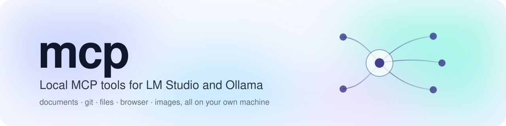
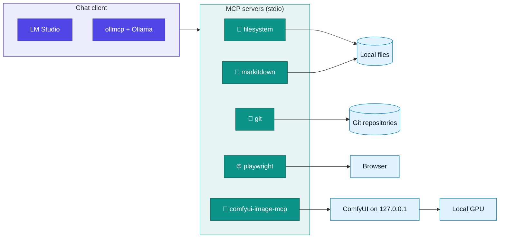

<p align="center">
  <picture>
    <source media="(prefers-color-scheme: dark)" srcset="assets/banner-dark.svg">
    
  </picture>
</p>

<p align="center">
  <a href="LICENSE"></a>
  
  
  
  
  
</p>

<p align="center">
  <a href="#quick-start">Quick start</a> ·
  <a href="docs/third-party-servers.md">Servers</a> ·
  <a href="servers/comfyui-image">Image server</a> ·
  <a href="docs/lm-studio.md">LM Studio</a> ·
  <a href="docs/ollama.md">Ollama</a> ·
  <a href="CONTRIBUTING.md">Contributing</a>
</p>

MCP (Model Context Protocol) tools for running local language models with real
capabilities, such as reading documents, working in Git repositories, browsing and
generating images, from [LM Studio](https://lmstudio.ai) or an
[Ollama](https://ollama.com) MCP client. Everything runs on the local machine; nothing
here needs an account or a cloud API.

## How it fits together



## What's here

| Path | What it is |
|---|---|
| [`servers/comfyui-image/`](servers/comfyui-image) | **comfyui-image-mcp**, an MCP server that generates images with a local ComfyUI (`generate_image`, `list_checkpoints`, `free_image_memory`) |
| [`tools/mcp_smoke_test.py`](tools/mcp_smoke_test.py) | Starts any stdio MCP server from an `mcpServers` config or command line, lists its tools and calls one |
| [`examples/`](examples) | `mcpServers` configs for Windows and Linux/macOS with every server below |
| [`docs/third-party-servers.md`](docs/third-party-servers.md) | Install and usage notes for the third-party servers |
| [`docs/lm-studio.md`](docs/lm-studio.md) | Using the servers from LM Studio |
| [`docs/ollama.md`](docs/ollama.md) | Using the servers with Ollama through an MCP client |

## The server set

| | Server | Gives the model | Source |
|---|---|---|---|
| 📁 | filesystem | Read/write/search files in chosen folders | npm `@modelcontextprotocol/server-filesystem` |
| 📄 | markitdown | PDF, DOCX, PPTX, XLSX, HTML → Markdown | PyPI `markitdown-mcp` |
| 🌿 | git | Status, diff, log, stage, commit, branch (no push) | PyPI `mcp-server-git` |
| 🌐 | playwright | A real browser | npm `@playwright/mcp` |
| 🎨 | image | Local text-to-image | this repo, plus ComfyUI and a checkpoint |

Only `comfyui-image-mcp` and the smoke-test tool live in this repository. The others are
installed from their package registries. ComfyUI, PyTorch and model weights are large
downloads and are documented, not committed.

## Quick start

1. **Pick a folder for the servers**, e.g. `C:\mcp` or `/opt/mcp`. The examples use those.
2. **Install the third-party servers** you want, as described in
   [docs/third-party-servers.md](docs/third-party-servers.md). Each Python server gets
   its own virtual environment.
3. **Optional: image generation.** Install ComfyUI and a checkpoint, then this repo's
   server ([servers/comfyui-image/README.md](servers/comfyui-image/README.md)):
   ```sh
   python -m venv /opt/mcp/comfyui-image/.venv
   /opt/mcp/comfyui-image/.venv/bin/pip install ./servers/comfyui-image
   ```
4. **Configure the client.** Copy the matching file from [`examples/`](examples), fix
   the paths, and remove servers you didn't install:
   - LM Studio: merge it into `~/.lmstudio/mcp.json` ([docs/lm-studio.md](docs/lm-studio.md)).
   - Ollama: `ollmcp --servers-json <file>` ([docs/ollama.md](docs/ollama.md)).
5. **Check each server** before using it in a chat:
   ```sh
   pip install "mcp>=1.20,<2"
   python tools/mcp_smoke_test.py --config <file> --server markitdown
   ```

## Smoke-test tool

```text
python tools/mcp_smoke_test.py [--config FILE --server NAME | -- COMMAND ARGS...]
                               [--call TOOL] [--args JSON] [--save-dir DIR]
                               [--timeout SECONDS] [--max-chars N]
```

It prints the server name, every tool with the first line of its description and, with
`--call`, the result. Text is truncated to `--max-chars`, and images are saved to
`--save-dir`. Examples:

```sh
# list the tools of a configured server
python tools/mcp_smoke_test.py --config examples/mcp.posix.json --server git

# convert a document
python tools/mcp_smoke_test.py --config mcp.json --server markitdown \
  --call convert_to_markdown --args '{"uri": "file:///tmp/report.docx"}'

# run a server straight from the command line and save the image it returns
python tools/mcp_smoke_test.py --save-dir out --call generate_image \
  --args '{"prompt": "a lighthouse at dusk, oil painting"}' -- comfyui-image-mcp
```

## Keeping it local

- `comfyui-image-mcp` talks only to ComfyUI on loopback. When it starts ComfyUI, it binds
  ComfyUI to `127.0.0.1` with `--offline`.
- markitdown and git read and change only local files. markitdown will fetch `http(s)`
  URLs if the model asks it to.
- Playwright browses the internet by design. Leave it disabled in chats that should stay
  offline.
- `npx -y` contacts the npm registry each time a server starts. Install pinned versions
  locally for a fully offline setup
  ([how](docs/third-party-servers.md#pinning-versions-and-offline-use)).

## Removing everything

1. Delete the server entries from the client config (`mcp.json` / the ollmcp servers file).
2. Stop ComfyUI if it is running (see the image server README).
3. Delete the servers folder (each server is a self-contained virtual environment or
   npm folder), plus the ComfyUI checkout, its environment and any models.
4. Optional: `pip cache purge` and `npm cache clean --force` to drop downloaded packages
   (the ROCm PyTorch wheels alone are several GB).

## Contributing

Questions go in [Discussions](../../discussions), and bugs and requests in
[Issues](../../issues). Pull requests are welcome; see [CONTRIBUTING.md](CONTRIBUTING.md).
Report security problems privately ([SECURITY.md](SECURITY.md)). Everyone taking part
is expected to follow the [Code of Conduct](CODE_OF_CONDUCT.md).

## License

[MIT](LICENSE). Use, fork, modify and redistribute freely. The third-party servers,
ComfyUI, PyTorch and model weights have their own licences.
